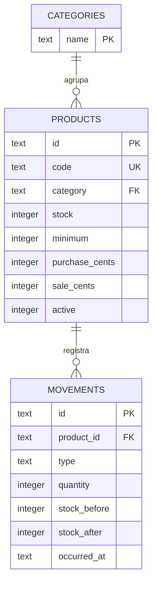

# Modelo de datos y persistencia

Base SQLite `ambar.db`, esquema versión 1. En Android se conserva en el almacenamiento privado de la aplicación. En la vista web se usa SQLite/WASM con persistencia IndexedDB vinculada al origen del navegador. Desinstalar la app o borrar los datos del navegador puede eliminar la información.

## Relaciones

## Diccionario

| Tabla | Campo | Tipo y significado |
|---|---|---|
| categories | name | Clave de categoría, comparación sin distinguir mayúsculas |
| products | id | UUID interno, inmutable |
| products | code | Código único incluso entre productos inactivos; 1–48 caracteres ASCII admitidos |
| products | name | Nombre de hasta 100 caracteres |
| products | description | Descripción opcional; formulario limitado a 500 caracteres |
| products | category | Referencia al nombre de categoría |
| products | purchase_cents / sale_cents | Precio entero en centavos, no negativo |
| products | minimum | Umbral de alerta, entero no negativo |
| products | stock | Existencias actuales, entero no negativo |
| products | photo | Fotografía opcional codificada en base64 |
| products | active | 1 activo, 0 inactivo |
| movements | id | UUID único del movimiento |
| movements | product_id | Referencia al producto con borrado restringido |
| movements | product_name / product_code | Instantánea histórica al confirmar |
| movements | type | entry, exit o adjustment |
| movements | quantity | Unidades operadas; en ajuste es el conteo físico absoluto |
| movements | stock_before / stock_after | Existencias antes y después |
| movements | reason | Motivo o justificación obligatoria, hasta 500 caracteres |
| movements | responsible | Nombre del responsable local al confirmar |
| movements | occurred_at | ISO 8601 en UTC, convertido a hora local para mostrar |
| settings | id | Fila única con clave 1 |
| settings | store / responsible | Nombres configurables de tienda y responsable |
| settings | currency | GTQ, USD, MXN o EUR; unidad de presentación sin conversión automática |

La categoría usa una clave natural en este alcance. No se implementa renombrado global de categorías: al editar un producto se puede seleccionar una existente o crear otra.

## Consistencia

- Índice único en `products.code` y validación de duplicados antes de guardar.
- Claves foráneas activadas al abrir la conexión.
- Restricciones CHECK impiden existencias y precios negativos.
- Triggers rechazan UPDATE y DELETE sobre movimientos.
- Índice sobre producto y fecha para el historial.
- Alta con existencias iniciales: producto con stock cero, entrada inicial y actualización dentro de la misma transacción.
- Movimiento: lectura del stock vigente, validación de dominio, inserción y actualización dentro de la misma transacción.
- La edición del producto excluye stock, identidad interna y estado activo del conjunto de campos editables.

El CSV es un reporte de inventario, no una copia completa restaurable de la base de datos. No incluye fotografías ni permite recuperar todo el historial. El respaldo/restauración y la sincronización están fuera del alcance de esta versión.

## Migraciones

Antes de cambiar el esquema, incrementar la versión y añadir `onUpgrade` con una migración no destructiva y pruebas con un archivo de la versión anterior. Nunca borrar tablas para actualizar una instalación en uso.
